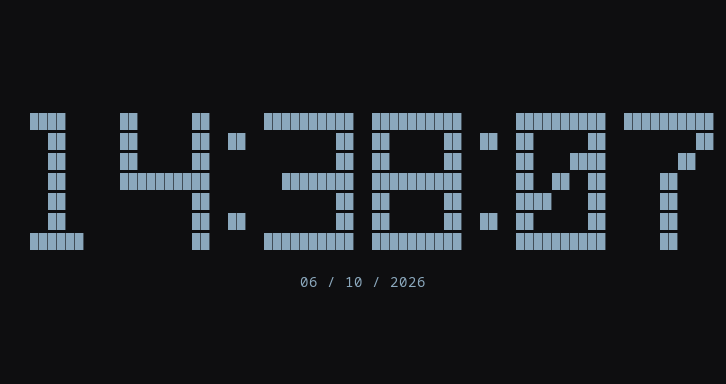

# Themed Clock

[English](README.md) · [Los diez temas animados](docs/THEMES.md)

Reloj de caracteres adaptable con diez animaciones temáticas. Funciona en una
terminal con la biblioteca estándar de Python, sin imágenes ni compilación.



## Inicio

Requiere Linux, Python 3.10+, Make para instalar y una terminal UTF-8 con fuente
monoespaciada. Kitty ofrece la apariencia original; no depende de su protocolo
gráfico ni de Wayland.

```sh
git clone https://github.com/Naraku86/themed-clock.git
cd themed-clock
make install
~/.local/bin/themed-clock --theme dune
```

Los números crecen por niveles proporcionales y después conservan su tamaño y se
centran. Los segundos aparecen del mismo tamaño cuando caben; la fecha no desplaza
el reloj. Las animaciones se adaptan a la terminal y después revelan la hora actual.

`S` / `W`: animar · `R`: recargar configuración · `Q` / `Esc`: salir.

## Configuración e integración

Selecciona el tema con `--theme`. La configuración opcional está en
`~/.config/themed-clock/config.ini` o `$XDG_CONFIG_HOME/themed-clock/config.ini`.
Puedes elegir números, colores, efectos y tiempos.

[Configuración e integración con el escritorio](docs/CONFIGURATION.es.md) ·
[Vistas animadas](docs/THEMES.md) · [Licencia y procedencia](NOTICE.md)

## Desarrollo

`make test` verifica todos los temas, tamaños, segundos, extremos de animación y
redimensionamiento en una pseudoterminal real. El código y los comentarios están
en inglés. `frame()` está separado de la terminal para reutilizarlo con contadores.

Licencia MIT. Pomodoro, alarmas y control por IA quedan para una segunda fase y
no están implementados. Los GIFs son demostraciones del dibujo, no grabaciones.
