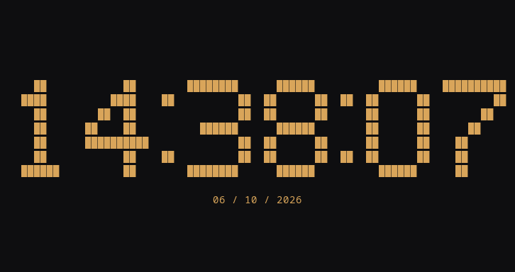
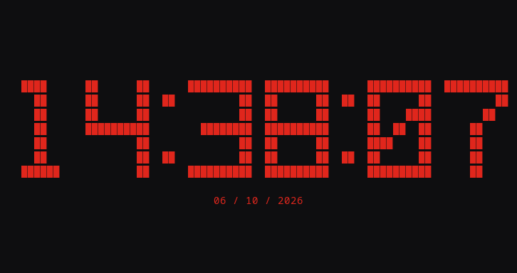
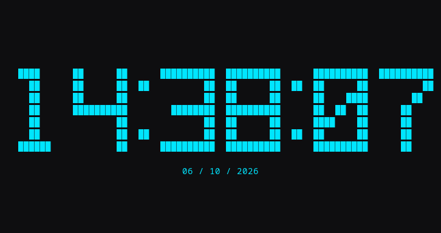
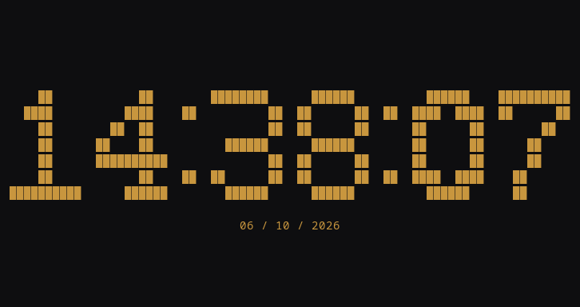
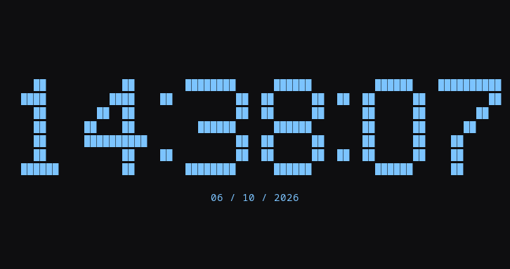
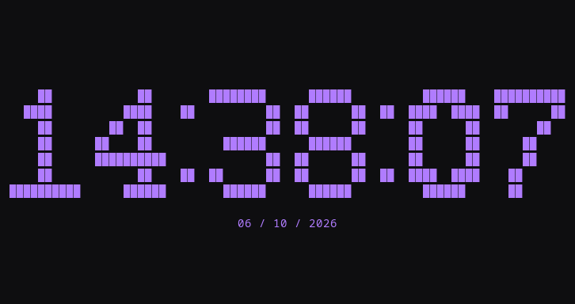
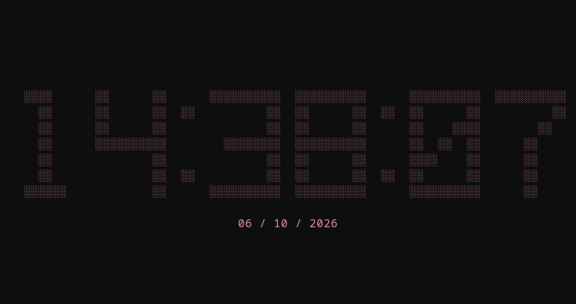
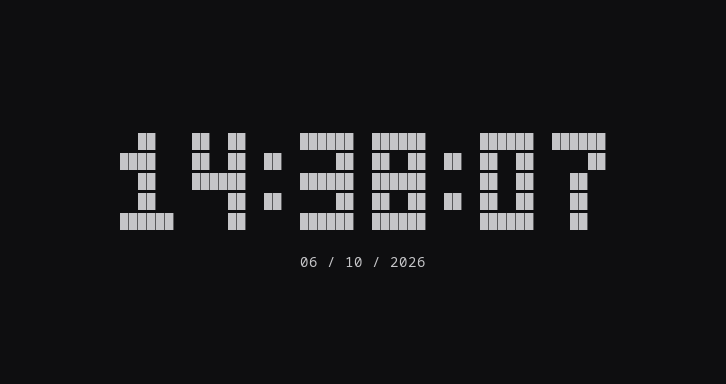

# Animated themes / Temas animados

[English README](../README.md) · [README español](../README.es.md)

Renderer demos at 78 columns × 18 rows. / Demostraciones a 78 columnas × 18 filas.

## Dune

`--theme dune` · Arrakis / sandstorm / tormenta de arena

## BLAME!

`--theme blame` · Industrial / block megastructure / megaestructura de bloques

## Akira

`--theme akira` · Industrial / energy wave / onda de energía

## Cyberpunk

`--theme cyberpunk` · Industrial / data rain / lluvia de datos

## Dwarven

`--theme dwarven` · Inscription / forge / forja

## Foundation / Fundación

`--theme foundation` · Geometric / orbits / órbitas

## Discworld / Mundodisco

`--theme discworld` · Inscription / hourglass / reloj de arena

## Lain

`--theme lain` · Soft industrial / wired connections / conexiones

## NERV

`--theme nerv` · Industrial / MAGI

## Minimal

`--theme minimal` · Compact / subtle pulse / pulso discreto

